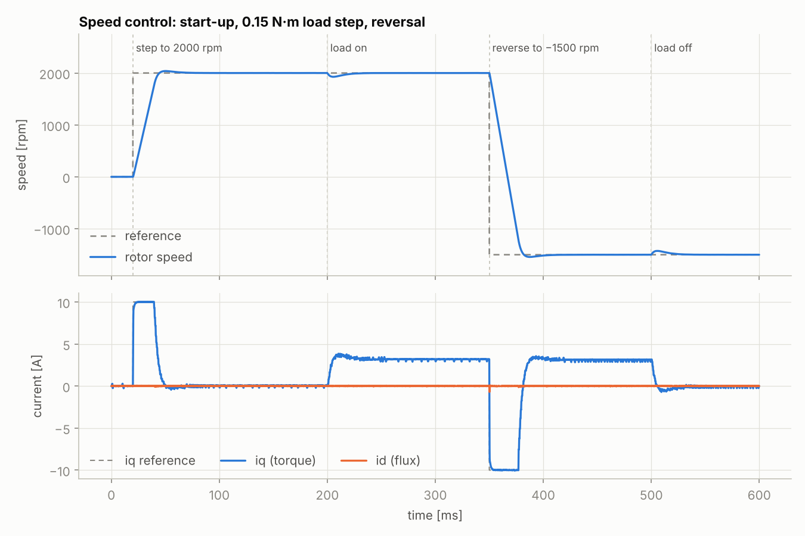
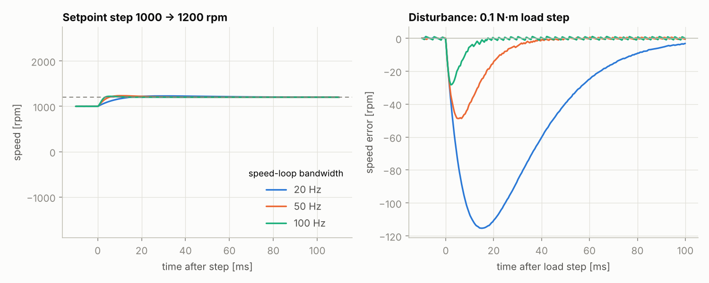
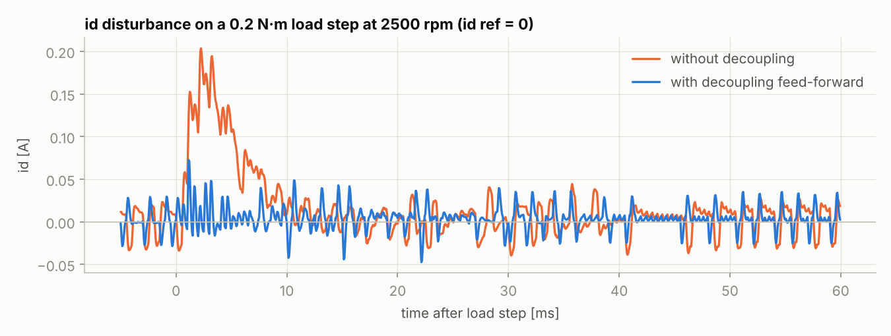
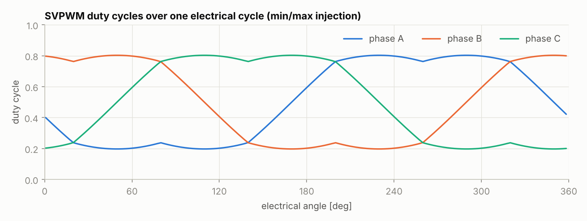
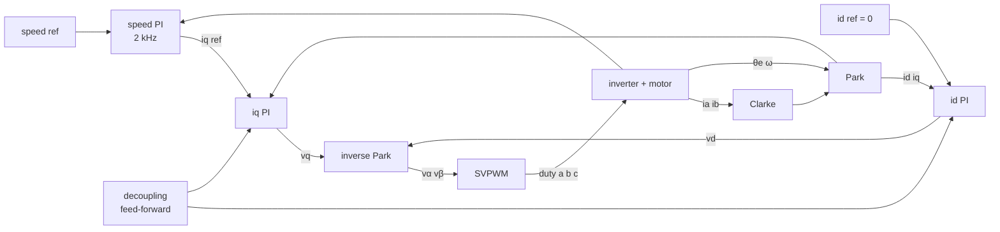

# foc-motor-control

Portable **field-oriented control (FOC)** library in C99 for BLDC / PMSM motors, verified in closed loop against a physics model of the motor. The simulator drives the *same* C code that runs on the MCU, so control behaviour is proven on the host before any hardware is powered.



## What it does

- **Cascaded control:** speed PI → d/q current PI → space-vector PWM, called once per PWM period from the ADC interrupt.
- **Model-based auto-tuning in firmware:** `foc_tune()` derives all four PI gains from R, L, flux, inertia and the target bandwidths, and rejects unsafe choices (current loop too fast for the PWM rate, speed loop too close to the current loop).
- **Decoupling feed-forward:** cancels the ωL cross-coupling and back-EMF terms, so a load step barely disturbs flux current.
- **Saturation handled properly:** d-axis priority on the voltage circle, conditional-integration anti-windup, and a hard current limit.
- **Min/max-injection SVPWM:** same output as 7-segment SVPWM without sector lookup tables; 15 % more usable voltage than sine PWM.
- **Small and MCU-friendly:** no dynamic memory, single-precision float only, about 2 KB of flash on Cortex-M4F (GCC -O2). CI cross-compiles it for Cortex-M4F on every push. Targets Cortex-M4F/M7, ESP32 and other MCUs with an FPU.

## Results (simulated 24 V, 4-pole-pair motor, 20 kHz PWM)

| Test | Result |
| --- | --- |
| Start-up 0 → 2000 rpm (current-limited at 10 A) | 17.6 ms rise (10–90 %), 1.9 % overshoot |
| 0.15 N·m load step at 2000 rpm | 73 rpm dip, zero steady-state error |
| id disturbance on a 0.2 N·m load step at 2500 rpm | 0.20 A without decoupling → 0.07 A with feed-forward |
| Speed reversal 2000 → −1500 rpm under load | clean, no integrator wind-up |

The simulation includes what makes real FOC hard: 14-bit encoder quantisation, M-method speed estimation, current ADC noise and quantisation, and a one-PWM-period computation delay.

### Tuning study

`foc_tune()` at three speed-loop bandwidths. Higher bandwidth cuts the load-step dip from 115 rpm (20 Hz) to 28 rpm (100 Hz); the right choice depends on the mechanical load and encoder noise.



| Speed bandwidth | Rise 10–90 % | Overshoot | Settle (2 %) | 0.1 N·m load dip |
| --- | --- | --- | --- | --- |
| 20 Hz | 10.7 ms | 14.5 % | 84 ms | 115 rpm |
| 50 Hz | 3.7 ms | 17.4 % | 33 ms | 49 rpm |
| 100 Hz | 2.2 ms | 10.3 % | 14 ms | 28 rpm |

### Decoupling and SVPWM





## Architecture



Everything left of the inverter is the C library (`src/`). In simulation the inverter and motor are the Python model (`sim/`); on hardware they are your power stage.

## Using it in firmware

```c
#include "foc/foc_ctrl.h"

static foc_ctrl_t g_foc;

void motor_init(void)
{
    const foc_motor_t motor = {
        .rs = 0.5f, .ls = 0.5e-3f, .flux = 0.008f, .pole_pairs = 4,
        .inertia = 5e-5f, .friction = 1e-5f,
    };
    foc_config_t cfg;
    /* 20 kHz current loop, speed loop every 10th period, 1 kHz / 50 Hz bandwidth, 10 A limit */
    if (foc_tune(&motor, 50e-6f, 10, 1000.0f, 50.0f, 10.0f, &cfg) != 0) {
        fault("unsafe tuning");
    }
    foc_ctrl_init(&g_foc, &cfg);
    foc_ctrl_set_mode(&g_foc, FOC_MODE_SPEED);
    foc_ctrl_set_speed(&g_foc, 2000.0f * 2.0f * FOC_PI / 60.0f);
}

/* ADC end-of-conversion interrupt, synchronised to the PWM centre */
void ADC_IRQHandler(void)
{
    foc_input_t in = {
        .ia = adc_phase_a_amps(), .ib = adc_phase_b_amps(),
        .theta_e = encoder_elec_angle(), .omega_m = encoder_speed(),
        .vdc = adc_vbus_volts(),
    };
    foc_output_t out;
    foc_ctrl_step(&g_foc, &in, &out);
    pwm_set_duty(out.duty.a, out.duty.b, out.duty.c);
}
```

Hardware glue (ADC scaling, encoder, timer) stays in your BSP; the library has no MCU dependencies.

## Auto-tuning rules

| Loop | Plant | Gains | Result |
| --- | --- | --- | --- |
| Current | R + sL | Kp = L·ωc, Ki = R·ωc | PI zero cancels the electrical pole: first-order loop with bandwidth ωc |
| Speed | Kt / (J·s) | Kp = J·ωs / Kt, Ki = Kp·ωs / 4 | Symmetric optimum, a = 2: about 37° phase margin, fast load rejection |

`foc_tune()` refuses current bandwidths above 10 % of the PWM rate and speed bandwidths above one fifth of the current bandwidth.

## Build and test

```bash
cmake -S . -B build && cmake --build build
ctest --test-dir build --output-on-failure      # C unit tests (transforms, SVPWM, PI, tuner)

pip install -r requirements.txt
python -m pytest                                # closed-loop tests against the motor model
python -m sim.run                               # regenerate all figures in docs/
```

## Layout

```
include/foc/   public headers: foc_math.h, foc_pi.h, foc_ctrl.h
src/           library sources (no OS, no heap)
tests/         C unit tests + Python closed-loop tests
sim/           PMSM model, sensor model, ctypes binding, scenarios and plots
docs/          generated figures
```

## Roadmap

- Fixed-point (Q15/Q31) build for MCUs without an FPU
- Sensorless operation with a sliding-mode or flux observer
- Field weakening above base speed
- Hardware validation on an STM32 G4 / ESP32 motor-control board

## License

MIT, see [LICENSE](LICENSE). Author: Manish Soni.
